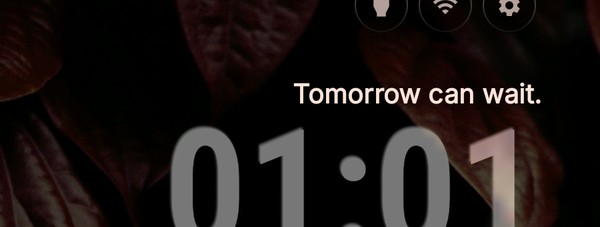
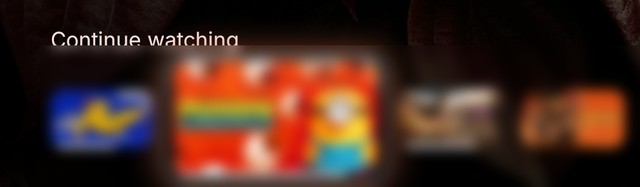
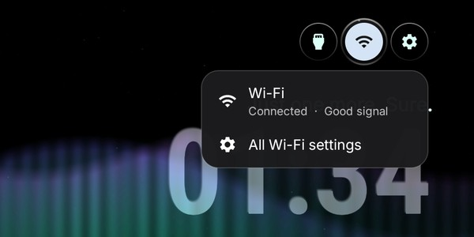

<p align="center"></p>

<h3 align="center">Your TV, as a picture frame.<br>A Google TV-style Home at a third of the memory.</h3>

<p align="center"></p>

## ✦ Why DisplayX

◆ **Glass that moves.** Focus springs between apps and stretches on the way, so you see where you are from the sofa.

<p align="center"></p>

◆ **A new line every time you come Home.** It follows the hour, and the weather if you turn it on.

<p align="center"></p>

◆ **Frosted glass clock.** Your wallpaper shows through the digits, which stay readable on any picture.

<p align="center"></p>

◆ **Continue watching.** Resume your shows in one press. The focused one grows, the rest step back.

<p align="center"></p>

◆ **Menus on frosted glass.** Wi-Fi, inputs and settings open right on Home.

<p align="center"></p>

◆ **Wallpaper mode and AMOLED wallpapers.** After 5 s idle only the picture and the time remain; the next press just
wakes it. The included wallpapers are true black, so OLED pixels switch off. Or bring your own photos.

<p align="center"></p>

◆ **Light.** 64 MB against Google TV home's ~176 MB. No ads, no tracking, no account.

<sub>Glass, greetings and wallpapers: Google TV emulator. Clock, Continue watching and menus: a real TCL Google TV,
posters blurred on purpose.</sub>

## ▸ Install in one command

On the TV: **Settings › System › About**, press **Build** 7 times, then **Developer options › Wireless debugging › On**.<br>
On a Windows PC on the same Wi-Fi:

```powershell
powershell -ExecutionPolicy Bypass -File install.ps1 -Tv <address shown under Wireless debugging>
```

It pairs, installs, adds the wallpapers and makes DisplayX your Home. Then four optional choices, picked with the arrow keys,
each showing what it costs. Press Enter four times and nothing extra goes online:<br>
**wallpapers** (AMOLED set or your photos) · **a name** (or none) · **weather** (off, found automatically, or your city) · **update notes** (off or on).

<p align="center"></p>

↺ **Undo:** `adb uninstall tv.displayx.home`, and your old Home is back.

## ◉ How it compares

<p align="center"></p>

| | Memory | Feel |
|---|---|---|
| Google TV home | ~176 MB + 96 MB background | Ads and rows of recommendations |
| **DisplayX** | **64 MB** | Your pictures, glass, Continue watching |
| cleanyourtv default | 29 MB | Minimal grid |

<sub>Same Google TV 14 emulator, same apps. On real TVs DisplayX measured 43 MB (1.8 GB Haier) and 63–84 MB (2.4 GB TCL).</sub>

## ✓ Safe by design

✓ **No account, no ads, no tracking.** It goes online only for poster images and, if you ask, the weather.<br>
✓ **Installs beside your TV's own Home.** Nothing is deleted, and it's undone in one command.<br>
✓ **Keeps your accessibility services.** TalkBack and others stay on.<br>
✓ **Tested.** 10,000 random remote presses with no crash, 309 unit tests, and lint with 0 errors.

<details><summary><b>Permissions, build from source, settings</b></summary>

**Permissions**
- `READ_MEDIA_IMAGES`: your wallpapers.
- `READ_TV_LISTINGS`: Continue watching.
- `INTERNET`: posters from your streaming apps, and the opt-in weather from open-meteo.com.
- Accessibility (`HomeKeyService`): sends the Home button here on TVs whose Home button skips the chosen Home.

**Build from source**
1. Apply `source/displayx.patch` to [cleanyourtv](https://github.com/Gathin23/cleanyourtv) at `718f98c9`.
2. Run `./gradlew -p launcher assembleRelease -PlauncherApplicationId=tv.displayx.home -PlauncherAppLabel=DisplayX`.
3. Put the APK at `apk/displayx.apk`; the installer uses it instead of downloading.

**Settings** live in `theme/config.json`. [AGENTS.md](AGENTS.md) lists every key.
</details>

<sub><b>No affiliation.</b> DisplayX is an independent open-source project. It is not affiliated with, endorsed by or
sponsored by Google, TCL, Haier, any TV maker, any streaming service or any studio. App icons, show titles and
artwork that appear in screenshots belong to their owners and are shown only to illustrate how the Home displays
your own apps and shows; DisplayX promotes no show, app or wallpaper. Built on
<a href="https://github.com/Gathin23/cleanyourtv">cleanyourtv</a> (MIT). The bundled AMOLED wallpapers are drawn in
code and released under MIT. The leaves photo in the real-TV shots is used under the Unsplash licence. Inter font: SIL OFL.</sub>
