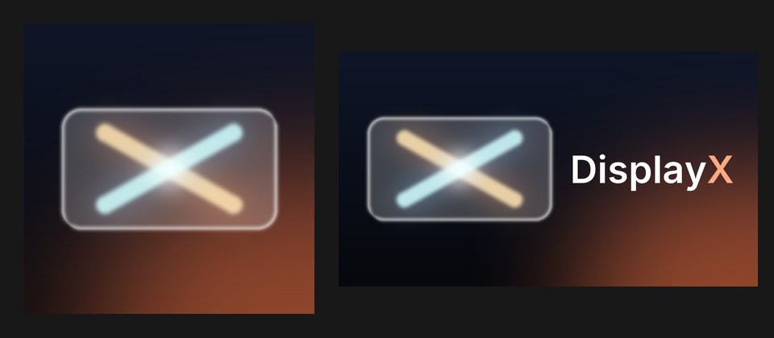
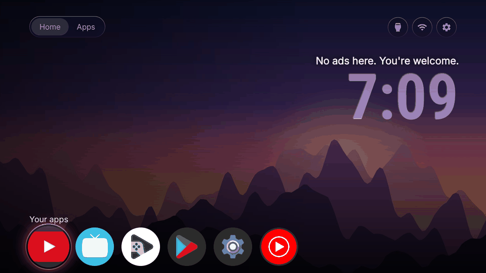
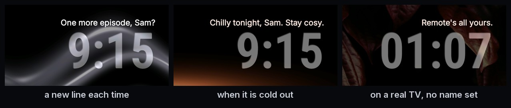
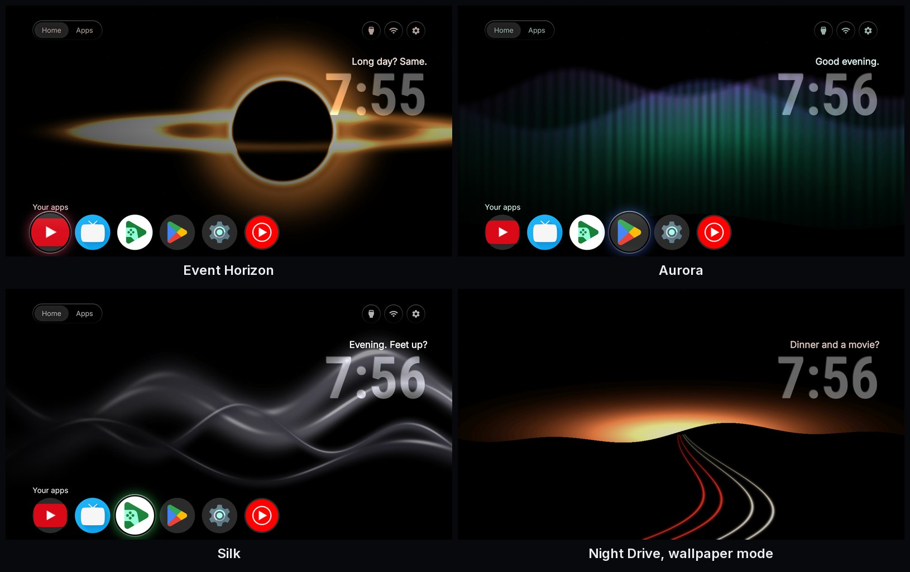
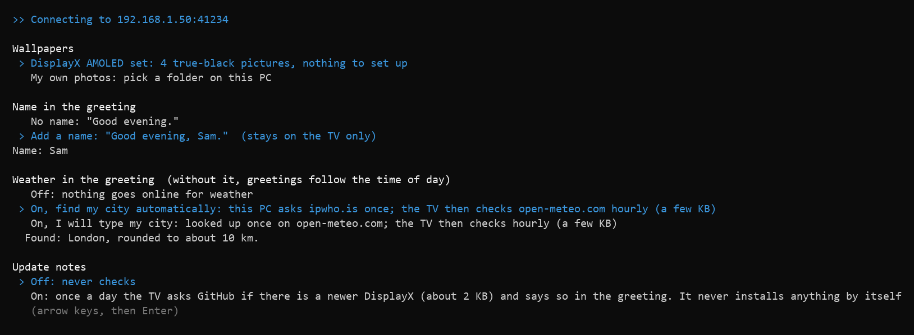

<p align="center"></p>

<h3 align="center">Your TV, as a picture frame.<br>A Google TV-style Home at a third of the memory.</h3>

<p align="center"></p>

## ✦ Why DisplayX

◆ **Glass that moves.** Focus springs between apps and stretches on the way, so you see where you are from the sofa.

<p align="center"></p>

◆ **A new line every time you come Home.** It follows the hour, and the weather if you turn it on.

<p align="center"></p>

◆ **Frosted glass clock.** Your wallpaper shows through the digits, which stay readable on any picture.

<p align="center"></p>

◆ **Continue watching.** Resume your shows in one press. The focused one grows, the rest step back.

<p align="center"></p>

◆ **Menus on frosted glass.** Wi-Fi, inputs and settings open right on Home.

<p align="center"></p>

◆ **Wallpaper mode, four photos included.** After 5 s idle only the picture and the time remain; the next press just
wakes it. Four photos come with it, or bring your own.

<p align="center"></p>

◆ **Light.** 64 MB against Google TV home's ~176 MB. No ads, no tracking, no account.

<sub>Real TCL Google TV, except the glass motion (Google TV emulator). Posters blurred on purpose.</sub>

## ▸ Install in one command

On the TV: **Settings › System › About**, press **Build** 7 times, then **Developer options › Wireless debugging › On**.<br>
On a computer on the same Wi-Fi, in the DisplayX folder. Windows (PowerShell):

```powershell
powershell -ExecutionPolicy Bypass -File install.ps1 -Tv <address shown under Wireless debugging>
```

macOS or Linux (Terminal):

```bash
bash install.sh <address shown under Wireless debugging>
```

<sub>On a Mac, if it says "No route to host": System Settings › Privacy & Security › Local Network › turn on your terminal app.</sub>

It pairs, installs, adds the wallpapers and makes DisplayX your Home. Then four optional choices, picked with the arrow keys,
each showing what it costs. Press Enter four times and nothing extra goes online:<br>
**wallpapers** (the four photos or yours) · **a name** (or none) · **weather** (off, found automatically, or your city) · **update notes** (off or on).

<p align="center"></p>

↺ **Undo:** `adb uninstall tv.displayx.home`, and your old Home is back.

## ◉ How it compares

<p align="center"></p>

| | Memory | Feel |
|---|---|---|
| Google TV home | ~176 MB + 96 MB background | Ads and rows of recommendations |
| **DisplayX** | **64 MB** | Your pictures, glass, Continue watching |
| cleanyourtv default | 29 MB | Minimal grid |

<sub>Same Google TV 14 emulator, same apps. On real TVs DisplayX measured 43 MB (1.8 GB Haier), 63–84 MB (2.4 GB TCL) and 79–99 MB (2 GB OnePlus 55Q1, Android 11, in a user's field test).</sub>

## ▣ Tested on

| Brand | Model | Year | Chip | RAM | OS | DisplayX | Home memory | Result |
|---|---|---|---|---|---|---|---|---|
| TCL | 55Q6C (55", India) | – | MediaTek | 2.4 GB | Google TV 14, patch Dec 2025 | v1.1 | 63–84 MB | ✓ Daily use, all effects on |
| Haier | MatrixTV DE | – | MediaTek MT9676 | 1.8 GB | Google TV 14, patch Dec 2025 | v1.0 | 43–68 MB | ✓ Daily use, photo slideshow |
| OnePlus | 55Q1 (55") | 2019 | MediaTek | 2 GB | Android TV 11 | v1.0 | 79–99 MB | ✓ Field test by a user; needed `"text_shadows": false` |
| Emulator | Google TV 14 (x86) | – | – | 2 GB | Google TV 14 | v1.1 | 62–65 MB | ✓ 10,000 random key presses, no crash |
| Emulator | Android TV 8 (x86) | – | – | 2 GB | Android TV 8 | v1.1 | – | ✓ Runs, wallpapers load |

<sub>Tried it on another TV? Open an issue with the brand, model, year, Android version and what worked, and it goes in this table.</sub>

## ✓ Safe by design

✓ **No account, no ads, no tracking.** It goes online only for poster images and, if you ask, the weather.<br>
✓ **Installs beside your TV's own Home.** Nothing is deleted, and it's undone in one command.<br>
✓ **Keeps your accessibility services.** TalkBack and others stay on.<br>
✓ **Tested.** 10,000 random remote presses with no crash, 313 unit tests, and lint with 0 errors.

<details><summary><b>Permissions, build from source, settings</b></summary>

**Permissions**
- `READ_MEDIA_IMAGES`: your wallpapers.
- `READ_TV_LISTINGS`: Continue watching.
- `INTERNET`: posters from your streaming apps, and the opt-in weather from open-meteo.com.
- Accessibility (`HomeKeyService`): sends the Home button here on TVs whose Home button skips the chosen Home.

**Build from source**
1. Apply `source/displayx.patch` to [cleanyourtv](https://github.com/Gathin23/cleanyourtv) at `718f98c9`.
2. Run `./gradlew -p launcher assembleRelease -PlauncherApplicationId=tv.displayx.home -PlauncherAppLabel=DisplayX`.
3. Put the APK at `apk/displayx.apk`; the installer uses it instead of downloading.

**Settings** live in `theme/config.json`. [AGENTS.md](AGENTS.md) lists every key.

**A grey box behind the clock?** Some MediaTek TVs draw the big text shadows as a box. Set `"text_shadows": false`; over bright, busy photos also set `"glass_clock": false`, since the glass clock relies on its dark halo.
</details>

## § Legal

<sub><b>No affiliation.</b> DisplayX is an independent open-source project. It is not affiliated with, endorsed by or
sponsored by Google, TCL, Haier, any TV maker, any streaming service, studio or photographer. Android, Google TV and all
other product names, logos, app icons, show titles and artwork that appear in screenshots are trademarks or copyright
of their respective owners. They are shown only to illustrate how the Home displays your own apps and shows (nominative
use); DisplayX promotes no show, app or brand.</sub>

<sub><b>Wallpapers.</b> The four included photos were downloaded from free stock-photo sites whose licences allow free
commercial use. Copyright stays with their photographers. They are not covered by this project's MIT licence and are not
sold; they are shipped only as optional wallpapers. Any resemblance to a film, game or character is not a claim of
connection to it.</sub>

<sub><b>Takedown.</b> If you own anything shown or included here and want it credited or removed, open an issue and it
will be handled promptly.</sub>

<sub><b>No warranty.</b> The code is MIT-licensed and provided "as is", without warranty of any kind. You install it on
your own TV at your own risk. Built on <a href="https://github.com/Gathin23/cleanyourtv">cleanyourtv</a> (MIT). Inter
font: SIL OFL.</sub>
