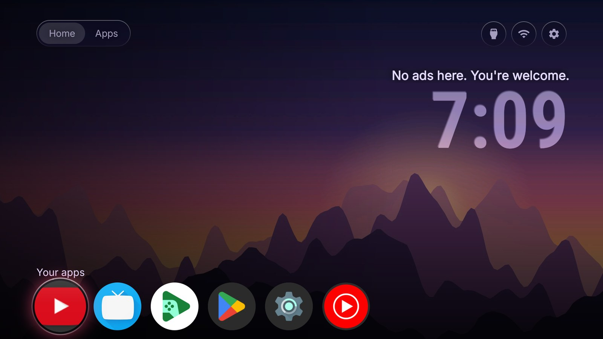
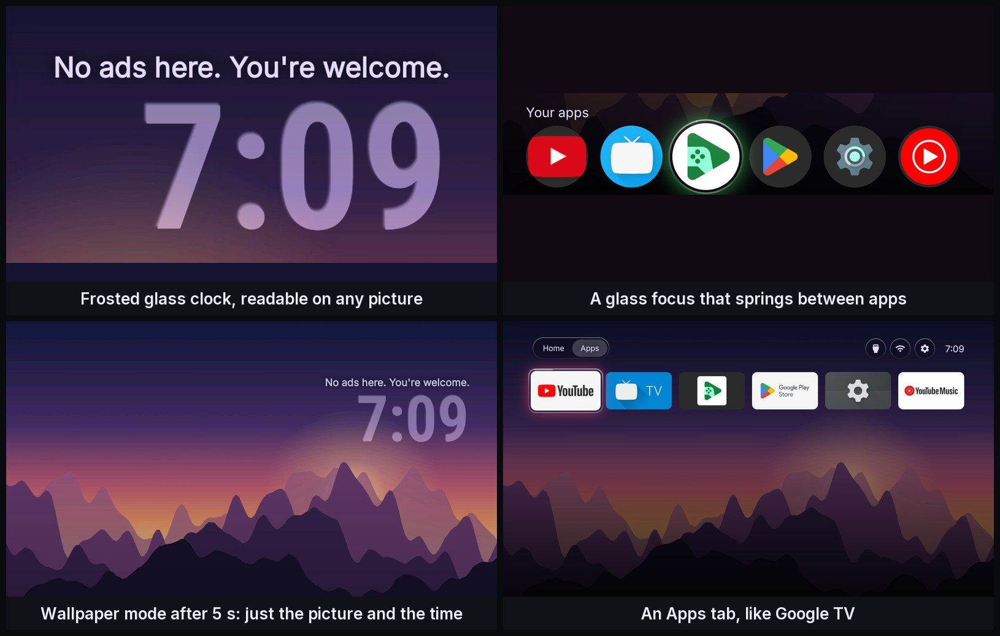
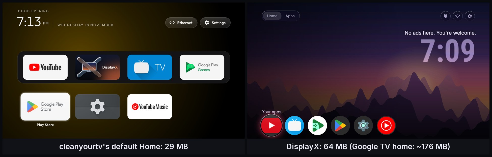

# DisplayX

**A Google TV-style Home that's wallpaper-first and light enough for 2 GB TVs.** It puts your pictures on the screen,
a frosted glass clock over them, and your apps and shows one press away. It's built on the
[cleanyourtv](https://github.com/Gathin23/cleanyourtv) launcher (MIT) and installs beside it.

## What you get

| Feature | What it does on the TV |
|---|---|
| **Frosted glass clock** | The wallpaper shows through big glass digits. A contrast floor keeps them readable, and a dark halo appears behind them over very bright or busy pictures |
| **Glass focus** | A glass outline springs from app to app and stretches as it moves, so you can see where you are from the sofa |
| **Wallpaper mode** | After 5 seconds idle only the picture, clock and greeting stay. The next button press only wakes the screen; it never opens anything by accident |
| **Continue watching** | Shows you were watching, from your streaming apps' own progress, one press away |
| **Your apps + Apps tab** | A row of your apps, and a full Apps tab like Google TV's. Rows you're not in fade back |
| **No pictures yet?** | With an empty wallpaper folder, Home shows a soft gradient in your first app's colour instead of a black screen |
| **Balanced slideshow** | Every picture in `Pictures/TV_Wallpapers` is shown about equally often, never twice in a row |
| **Greeting** | Lines by time of day, or by the weather if you opt in. No name unless you set one |
| **Google TV Home button** | On Google TV the installer adds the redirect that makes Home land here, and keeps Google's quick panel behind the gear working |

## How it compares

Measured on the same Google TV 14 emulator (2 GB) with the same apps, Home app memory (PSS):

| Home | Memory | Look |
|---|---|---|
| Google TV's own home | ~176 MB, plus ~96 MB of background services | Ads and recommendations |
| **DisplayX** | **64 MB** | Wallpaper-first: glass clock, Continue watching, Apps tab |
| cleanyourtv's default Home | 29 MB | Minimal: a clock and an app grid |

**When to pick which:**
- **DisplayX** if you want the Google TV layout (Continue watching, an Apps tab, a big clock over your pictures) at
  about a third of Google's memory.
- **cleanyourtv's own launcher** if you want the absolute lightest Home.

On real TVs, DisplayX's Home measured 43 MB on a 1.8 GB Haier and 63–84 MB on a 2.4 GB TCL, both Google TV 14.

## Build and install

1. Clone cleanyourtv at commit `718f98c9` and apply the change: `git apply source/displayx.patch`.
2. Build with its own app ID, so it installs beside the cleanyourtv launcher instead of over it (JDK 17, Android SDK 34):
   `./gradlew -p launcher testReleaseUnitTest assembleRelease -PlauncherApplicationId=tv.displayx.home -PlauncherAppLabel=DisplayX`.
   Copy `launcher/app/build/outputs/apk/release/app-release.apk` to `apk/displayx.apk`.
3. On the TV, turn on Developer options > Wireless debugging and pair once with `adb pair`.
4. Run `powershell -ExecutionPolicy Bypass -File install.ps1 -Serial <tv ip>:<port> -Package tv.displayx.home`.
   - It leaves every other accessibility service (TalkBack and others) as it was.
   - On Google TV it adds the Home redirect by itself.
5. Put your pictures in the TV's `Pictures/TV_Wallpapers` folder.
6. Replace `tv.displayx.home` with your own ID if you publish your own fork.
7. To change the look, edit `theme/config.json`. The keys are listed in cleanyourtv's `themes/README.md`, plus
   `glass_clock`, `liquid_glass`, `wallpaper_mode`, `wallpaper_fit`, `tile_glow_ring`, `keep_location_off`,
   `weather_location` and `settings_key_clear_task`. [AGENTS.md](AGENTS.md) explains each.

**Undo:** `adb uninstall tv.displayx.home`. Your TV's previous Home comes back.

## Permissions

Read these before you install.

| Permission | Why |
|---|---|
| `READ_MEDIA_IMAGES` | Your wallpapers, from `Pictures/TV_Wallpapers` |
| `READ_TV_LISTINGS` | Continue watching |
| `INTERNET` | Two uses. 1) Continue watching posters: the image addresses your streaming apps publish to Android's TV listings, fetched over HTTPS (capped in size). 2) Weather, only if you set `"weather_location": "lat,lon"` in the theme: open-meteo.com once an hour for that place, rounded to about 10 km. Without a location the greeting follows the time of day. Nothing else goes online |
| Accessibility service (`HomeKeyService`) | Sends the Home button here on TVs whose Home button skips the chosen Home (most Google TVs) |

## Tested

- **TVs:** TCL 55" Google TV 14 (2.4 GB) and Haier Google TV 14 (1.8 GB).
- **Emulator:** Google's Google TV 14 emulator (2 GB), set up fresh with no Google account.
  - The installer worked, and Home landed on DisplayX.
  - 10,000 random remote presses (about 8 minutes) caused no crashes and no freezes. Memory stayed flat at 62 to 65 MB,
    so nothing leaks.
- **Checks:** 309 unit tests and Android lint, with 0 errors.
- **Android TV 8 emulator (minSdk 26):** DisplayX installs, starts and runs without a crash, using 24 MB.
  - Not yet confirmed: the Home button handing over to DisplayX. That emulator image ignores injected Home presses even
    without DisplayX, so it needs a real Android 8 TV.
- **Installer fixes from these tests:**
  - It now detects whichever app keeps the Home button (Google TV, the old Android TV launcher, or a brand's) and adds
    the redirect for it.
  - Its final check works on Android 8 and 9.

## Credit and licence

- **Base:** built on cleanyourtv by Gathin23 and its contributors (MIT, see `LICENSE-cleanyourtv`).
- **Screenshot wallpapers:** cleanyourtv's `scenes` theme, drawn by code (MIT).
- **Font:** Inter, under the SIL Open Font License (`INTER-FONT-OFL.txt`).
- **App icons in the screenshots:** they belong to their makers.
